# MC Studio — 18 posts X

18 brouillons en anglais, dans un ordre de publication proposé. Chaque texte fait moins de 280 caractères. Rien n’a été publié ni programmé. Les légendes, titres et textes alternatifs ne font pas partie du texte du post.

## Projets récents vérifiés

- Souji Nova : dernier commit client observé le **2 novembre 2026** ; captures du site public le 3 novembre.
- Newlense et Abri Toi : derniers commits observés le **1er novembre 2026** ; captures des builds locaux existants le 3 novembre. Leur mise en production n’a pas été vérifiée.
- MC Studio : activité interne le 3 novembre, distincte des projets clients.

Ces dates attestent l’activité du dépôt, pas une livraison ou un lancement. Les premiers posts mettent en avant les trois projets récents.

## Utilisation

Copier uniquement le texte du post, joindre l’image indiquée et ajouter son texte alternatif. Publier les posts séparément ; espacer les reprises d’un même visuel. Les appels à DM sollicitent le besoin et le contexte du prospect. Aucun résultat de conversion, délai de livraison ou créneau disponible n’est inventé.

## 01 — Souji Nova · Project reveal

A cleaning business with this much personality deserves a website to match.

Our work for Souji Nova: cinematic imagery, editorial type, and a clear route to a quote.

Run a service business? DM us your website + what you want it to do better.

**243 caractères** · [Télécharger le visuel](assets/souji-hero.png)

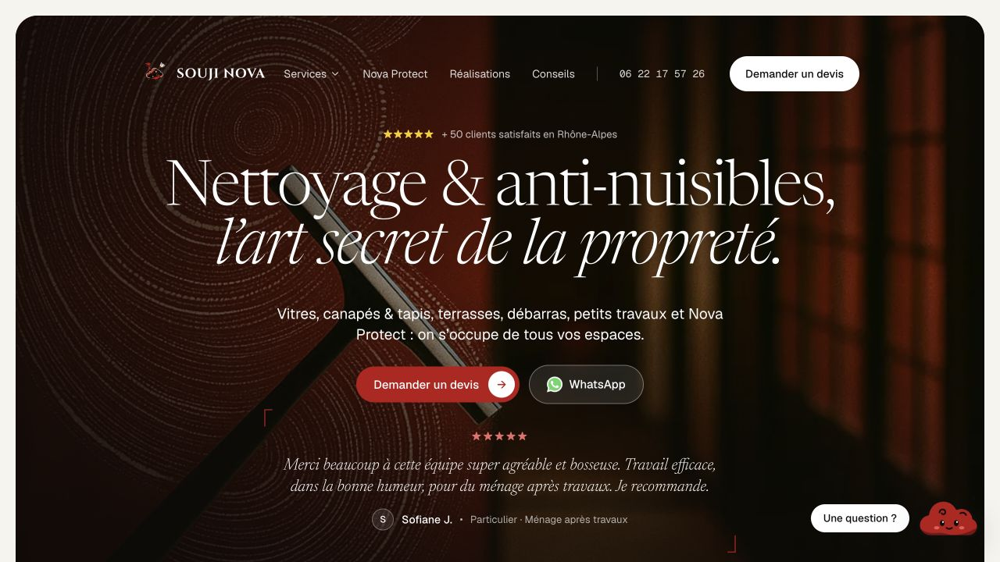

**Texte alternatif :** Souji Nova homepage with a dark cinematic background, large editorial typography, a customer review, and quote and WhatsApp buttons.

## 02 — Newlense · Product reveal

Your next customer walks into your shop. What brought them there?

We built Newlense around that question: a simple screen where customers tap how they found you.

Have a business problem that needs a small, focused app? Tell us about it.

**238 caractères** · [Télécharger le visuel](assets/newlense-welcome.png)

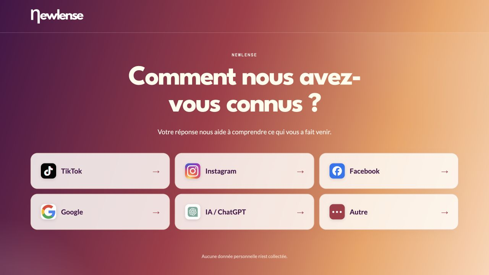

**Texte alternatif :** Newlense customer screen asks how visitors discovered the business. Six large choices cover TikTok, Instagram, Facebook, Google, AI/ChatGPT and other sources.

## 03 — Abri Toi · Project reveal

A place to sit. Shade to stay longer. People spending time outside.

For Abri Toi, we put the product in use at the centre of the website.

The first screen gives the technical details a reason to matter.

Have a physical product to bring online? DM us.

**253 caractères** · [Télécharger le visuel](assets/abri-hero.png)

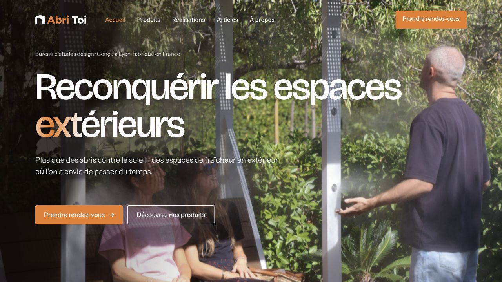

**Texte alternatif :** Abri Toi homepage shows people using an outdoor shelter, with a headline about reclaiming outdoor spaces and buttons to view products or book a meeting.

## 04 — Shika Consulting · Audience positioning

The most useful word on this homepage?

Associations.

Shika Consulting specialises in nonprofits. We made that visible in the headline, then gave visitors a way to estimate their budget or book a meeting.

Who should recognise themselves in your first screen?

**260 caractères** · [Télécharger le visuel](assets/shika-home.webp)

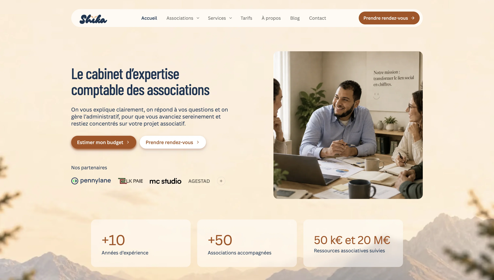

**Texte alternatif :** Shika Consulting homepage identifies the firm as an accounting specialist for nonprofits, with budget-estimation and meeting-booking buttons.

## 05 — Souji Nova · Lead capture

A quote request is part of your customer experience.

For Souji Nova, we designed a guided journey: profile, need, service, details. With phone and WhatsApp alongside it.

Want a clearer path from your website to an enquiry? DM us your URL.

**240 caractères** · [Télécharger le visuel](assets/souji-quote.png)

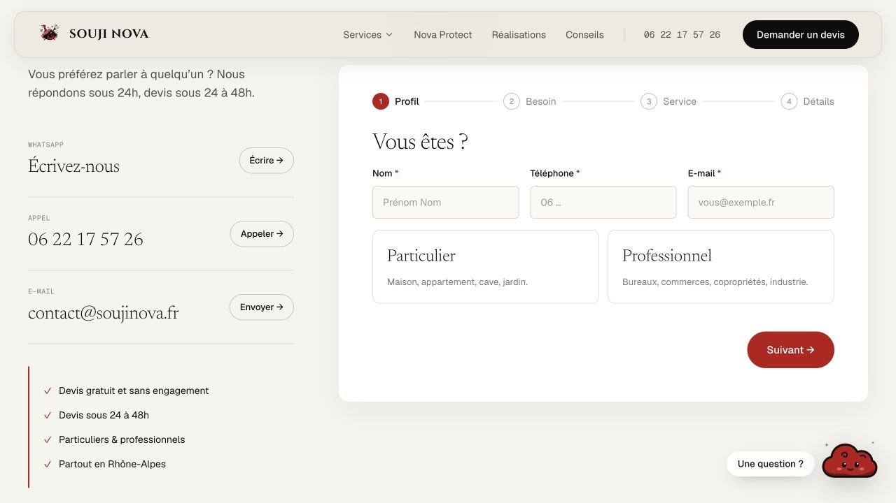

**Texte alternatif :** Souji Nova quote form with four labelled stages, blank contact fields, household and professional choices, and alternative contact options.

## 06 — Personal · Brand direction

Personal is an AI product for creators. Its identity needed a voice of its own.

Warm orange. Expressive type. A headline about the person using it.

One of our favourite directions from the portfolio.

Building a product? Let's give it an identity people remember.

**265 caractères** · [Télécharger le visuel](assets/personal-hero.png)

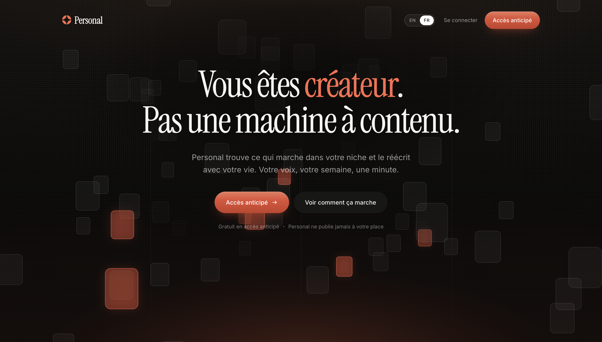

**Texte alternatif :** Personal landing page with a dark background, orange accents and expressive typography, introducing an AI product for creators.

## 07 — Abri Toi · Product navigation

Product names alone don't help buyers choose.

For Abri Toi, each card pairs the shelter with a use: taking a break, meeting outside, eating or working in the shade.

Help visitors picture where your product fits. Then give them the details.

**241 caractères** · [Télécharger le visuel](assets/abri-products.png)

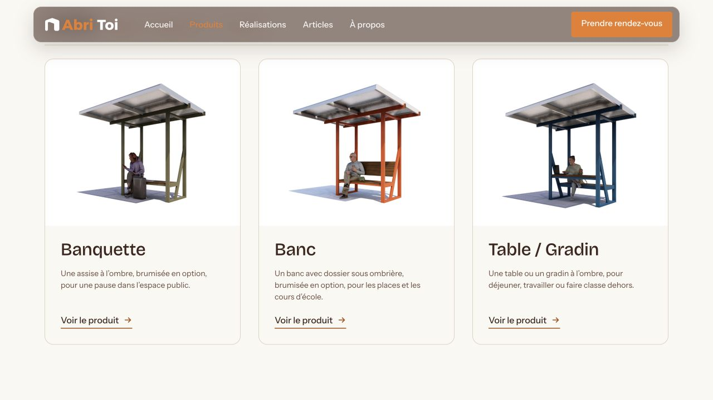

**Texte alternatif :** Abri Toi product cards show three Galiléo shelter models, their uses and links to the individual product pages.

## 08 — Maison AWL · Marketplace

What happens when your community wants to book your expertise?

For Maison AWL, we built a marketplace for finding providers, messaging, proposals and payments.

A place for the next step beyond content.

Creators: what does your audience keep asking you for?

**259 caractères** · [Télécharger le visuel](assets/maison-awl.png)

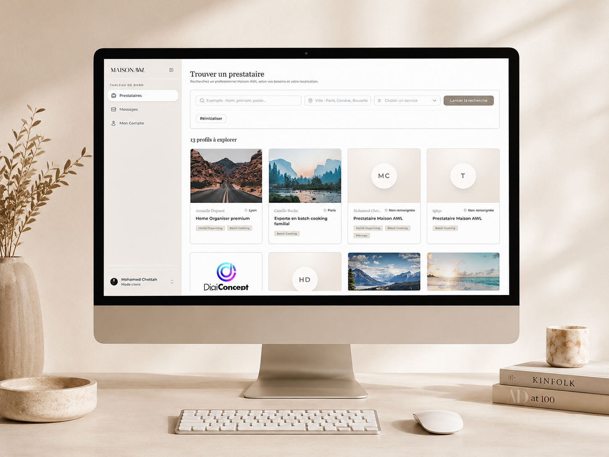

**Texte alternatif :** Existing Maison AWL portfolio mockup showing a desktop marketplace with provider search, location and service filters, and provider cards.

## 09 — Newlense · Focused interface

One question. Six choices.

Newlense's customer screen asks how someone found the business, then lets them answer with a tap.

Big targets, familiar channel icons, no long questionnaire.

For an in-store interface, every extra step deserves scrutiny.

**250 caractères** · [Télécharger le visuel](assets/newlense-welcome.png)

**Texte alternatif :** Newlense customer screen asks how visitors discovered the business. Six large choices cover TikTok, Instagram, Facebook, Google, AI/ChatGPT and other sources.

## 10 — AMG Promotion · Digital showroom

Your website should feel ready for the clients you want to work with.

For AMG Promotion, we created a digital showroom with product categories, client references and a direct route to an enquiry.

Has your business outgrown its website? DM us.

**244 caractères** · [Télécharger le visuel](assets/amg.png)

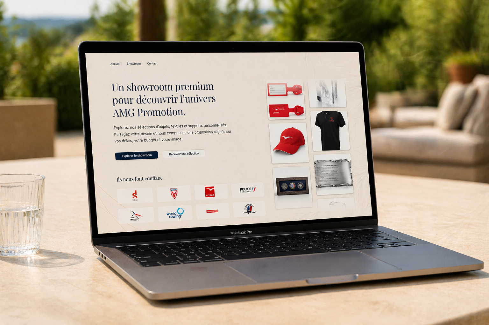

**Texte alternatif :** Existing AMG Promotion portfolio mockup showing its digital showroom, branded product imagery, enquiry options and customer references.

## 11 — Souji Nova · Audience paths

A homeowner and an office manager arrive with different needs.

On Souji Nova, visitors can switch between household and professional services.

A small interface choice that gives the offer more context.

Does your website help each type of buyer find their way?

**263 caractères** · [Télécharger le visuel](assets/souji-services.png)

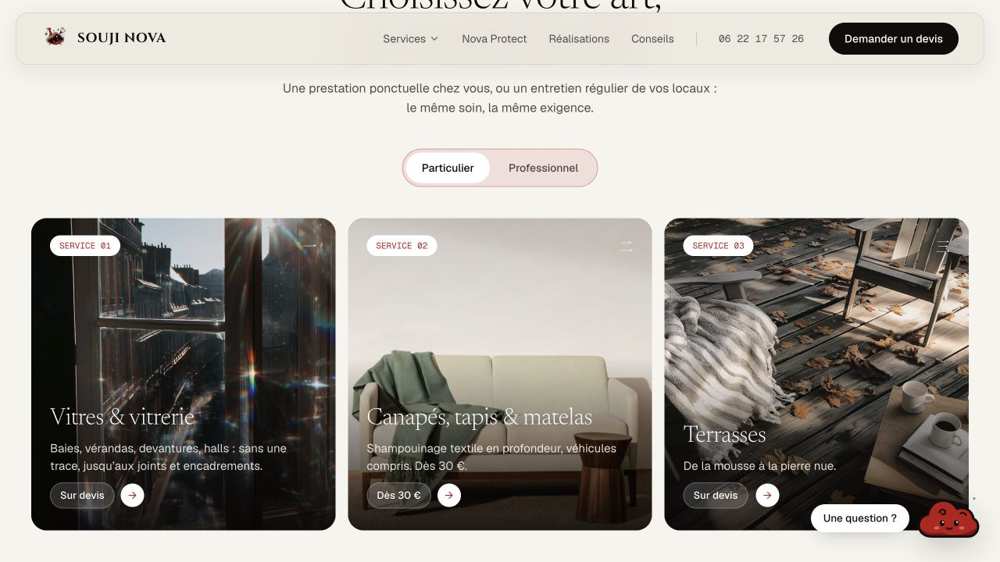

**Texte alternatif :** Souji Nova service cards for window cleaning, upholstery and terraces, with a household/professional selector above them.

## 12 — Personal · Product interaction

Inspiration needs a next step.

In Personal's feed, each content card leads to saving or remixing an idea. The action sits beside the inspiration.

We designed the interface around that moment.

Building a SaaS? DM us the workflow you want to improve.

**251 caractères** · [Télécharger le visuel](assets/personal-feed.webp)

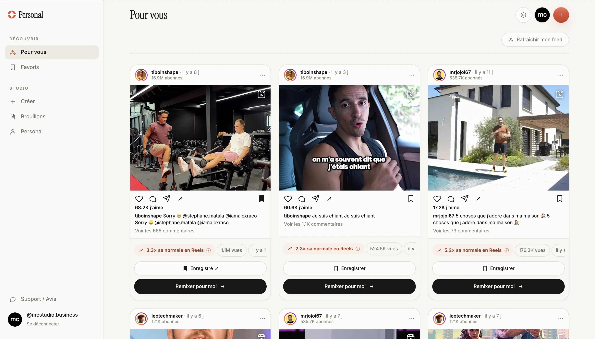

**Texte alternatif :** Personal content feed with inspiration cards and actions to save or remix an idea. The example social posts are interface content, not endorsements.

## 13 — Sotraya · Service positioning

How do you show a service that happens behind the scenes?

For Sotraya, we framed automation around the working day: connected tools, fewer repetitive tasks, room to grow.

Then a clear invitation to discuss the business.

Complex offer? Let's make it easier to explain.

**270 caractères** · [Télécharger le visuel](assets/sotraya.png)

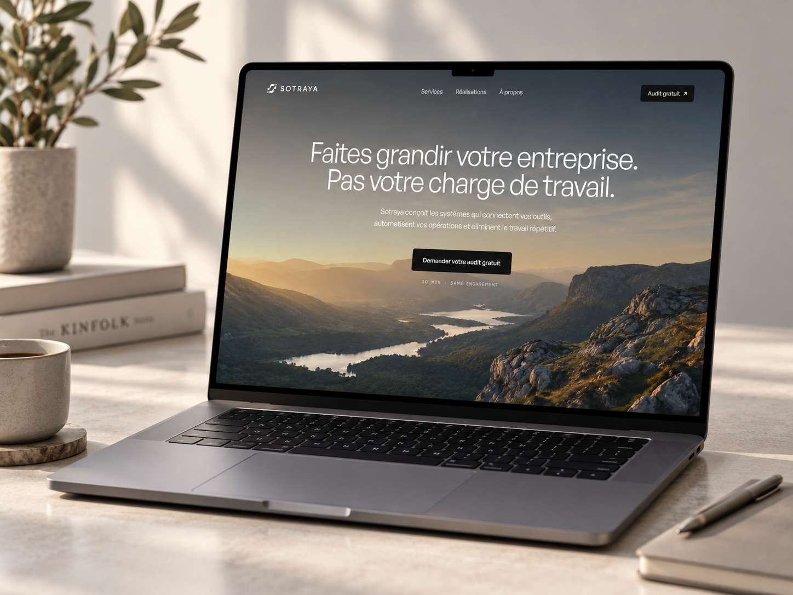

**Texte alternatif :** Existing Sotraya portfolio mockup showing its automation-service homepage on a laptop, with an invitation to request an audit.

## 14 — Abri Toi · Catalogue design

A catalogue is a series of decisions.

For Abri Toi, we organised shelters into product families, individual models and use cases, with a comparison section for the two ranges.

Selling a technical product? DM us what buyers struggle to choose.

**244 caractères** · [Télécharger le visuel](assets/abri-products.png)

**Texte alternatif :** Abri Toi product cards show three Galiléo shelter models, their uses and links to the individual product pages.

## 15 — R&A Energy · Complex service

Energy contracts are complicated. The first step on the website should be easy to find.

For R&A Energy, we created a brand and landing page around a clear explanation of the service and a route to contact.

Need to make your expertise easier to buy? DM us.

**257 caractères** · [Télécharger le visuel](assets/ra-energy.png)

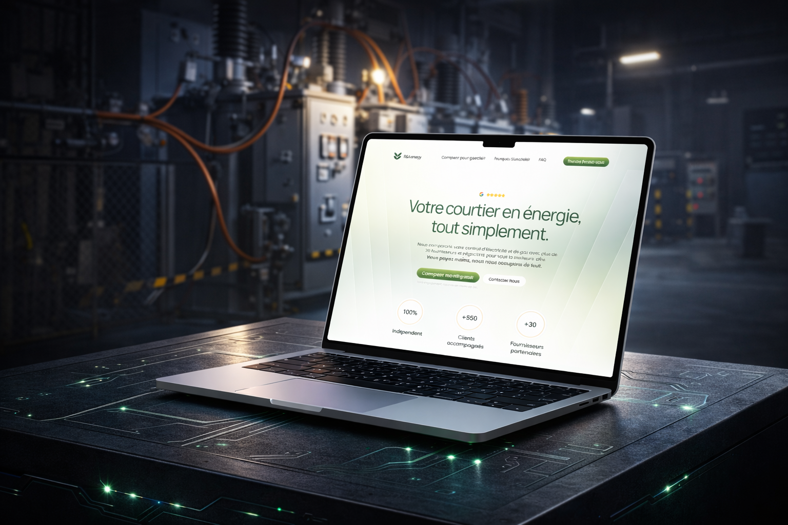

**Texte alternatif :** Existing R&A Energy portfolio mockup showing an energy-brokerage landing page on a laptop in an industrial setting.

## 16 — Newlense · Business utility

Useful software can start with one question your business keeps asking.

For Newlense: how did this customer find us?

A kiosk collects answers. A dashboard groups them by channel. CSV export makes them usable elsewhere.

What question would you build around?

**259 caractères** · [Télécharger le visuel](assets/newlense-welcome.png)

**Texte alternatif :** Newlense customer screen asks how visitors discovered the business. Six large choices cover TikTok, Instagram, Facebook, Google, AI/ChatGPT and other sources.

## 17 — Shika Consulting · Explain the process

Before booking a service, buyers want to know what working together looks like.

For Shika Consulting, we made the process visible, including how the firm sets up its clients' tools.

Give people something concrete to expect.

Does your site explain the next step?

**264 caractères** · [Télécharger le visuel](assets/shika-process.webp)

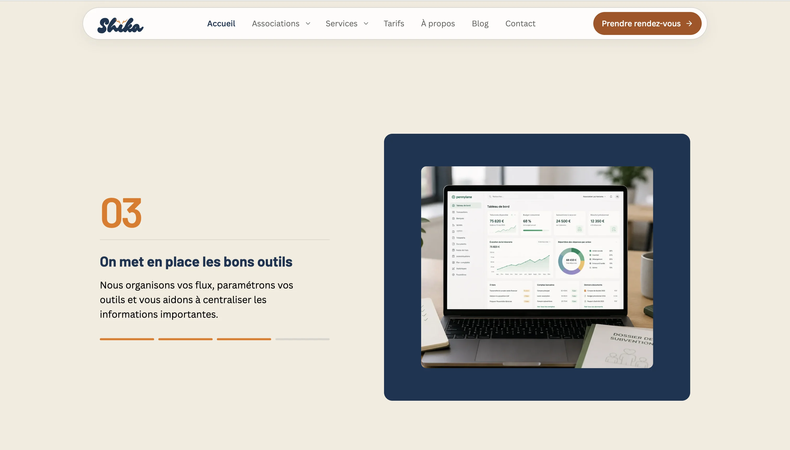

**Texte alternatif :** Shika Consulting website section describing how the firm sets up tools and centralises client information, accompanied by an illustrative laptop image.

## 18 — Souji Nova · Direct offer

Your team does great work. Your website should make that easy to see.

Souji Nova brings together service pages, customer reviews and a guided quote request in one visual identity.

We design and build websites for service businesses.

DM us your URL + your goal.

**263 caractères** · [Télécharger le visuel](assets/souji-hero.png)

**Texte alternatif :** Souji Nova homepage with a dark cinematic background, large editorial typography, a customer review, and quote and WhatsApp buttons.
